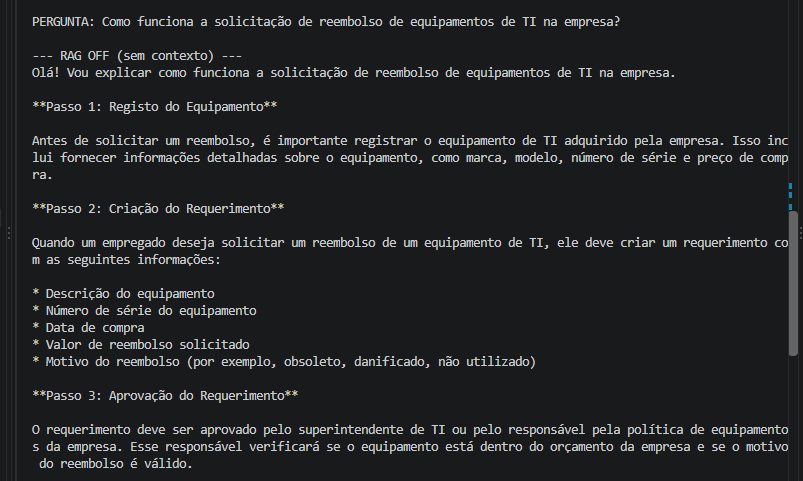
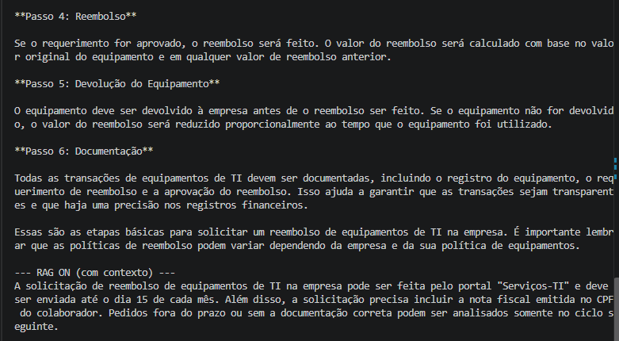
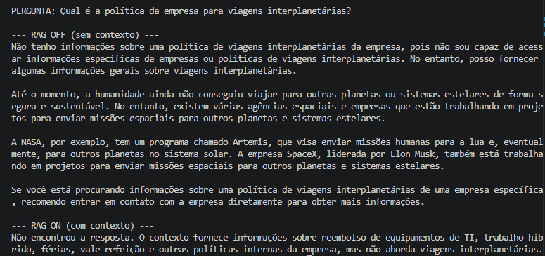

# Relatório — Pipeline RAG

**Aluno:** Taagny Augusto Reis da Silva  
**Curso:** Ciência da Computação  
**Disciplina:** Inteligência Artificial  
**Instituição:** UNIPAC Barbacena  
**Professor:** Felipe Roncalli de Paula Carneiro  
**Data:** 19/11/2026

## Item 1 — Captura de tela

Execução de rag_lab.py no Desafio 1, com pergunta dentro do contexto (reembolso) e fora do contexto (viagens interplanetárias).

## Item 2 — Análise do Desafio 1

Na execução real, o RAG OFF respondeu com um procedimento genérico de várias etapas, incluindo “Declaração de Uso”, verificação do uso e documentos não previstos na base. Ele não informou o portal, o prazo do dia 15 nem a exigência do CPF. No print 2, o RAG ON citou o portal **“Serviços-TI”**, o prazo do **dia 15** e a **nota fiscal emitida no CPF do colaborador**, além da análise no ciclo seguinte para pedidos fora do prazo ou sem documentação. Em outra execução, registrada em `capturas/saida_desafio1.txt`, o portal não apareceu na resposta final, embora o contexto recuperado contivesse essa informação. Isso mostra que a resposta do LLM pode variar entre execuções, enquanto o contexto recuperado manteve a política com o portal.

Na pergunta fora do contexto, sobre viagens interplanetárias, o RAG OFF produziu uma resposta genérica sobre limitações tecnológicas, riscos, custos e até programas de astronautas. O RAG ON foi mais adequado ao contexto da aplicação: respondeu **“Não encontrou a resposta”**, explicando que a base não contém essa política.

Essa diferença ocorre porque a memória paramétrica do modelo pode falhar em dados corporativos: as informações podem ser privadas, não fazer parte do conjunto de treinamento, estar desatualizadas ou não possuir uma fonte verificável. O RAG reduz esse problema ao buscar o conteúdo relevante em uma fonte externa e fornecê-lo ao modelo no momento da pergunta.

## Item 3 — Análise do Desafio 2

Na execução registrada, **chunk 40 / overlap 10** produziu similaridades de **0,547787**, **0,537774** e **0,474530**, mas os trechos eram fragmentos curtos. O RAG ON respondeu **“Não encontrou a resposta”** e mencionou “orçamento” e “cobertura das aulas”, assuntos que não aparecem na base de políticas. Isso caracteriza um Retrieval Failure: a fragmentação impediu que a busca reunisse, com sentido completo, a justificativa em 24 horas, o registro e a advertência após reincidência.

Com **chunk 500 / overlap 50**, o melhor resultado teve similaridade **0,662807** e misturou a regra do dia presencial com trechos de férias e vale-refeição, evidenciando a diluição de assuntos no mesmo vetor. Ainda assim, o RAG ON respondeu corretamente: a falta deve ser justificada em até 24 horas; sem justificativa, gera registro e, após reincidência, pode resultar em advertência. O trade-off é que chunks pequenos carregam pouco contexto e podem recuperar fragmentos sem sentido completo, enquanto chunks grandes preservam mais contexto, mas diluem a similaridade. Além disso, a divisão por caracteres corta palavras no meio, como em **“corporat”**, prejudicando a qualidade dos embeddings.

## Item 4 — Cálculo manual da Similaridade de Cosseno

Para `u = [1, 2]` e `v = [2, 1]`:

1. Produto escalar: `u · v = 1 × 2 + 2 × 1 = 4`.
2. Norma de `u`: `||u|| = √(1² + 2²) = √5`.
3. Norma de `v`: `||v|| = √(2² + 1²) = √5`.
4. Similaridade: `cos(θ) = 4 / (√5 × √5) = 4/5 = 0,8`.

O resultado 0,8 indica uma alta semelhança entre os vetores, embora eles não tenham a mesma direção. Em um sistema RAG, valores maiores representam embeddings mais próximos semanticamente, de acordo com o espaço vetorial aprendido pelo modelo.
